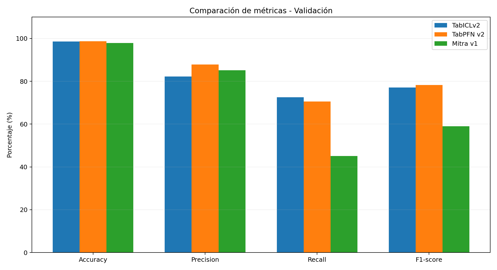
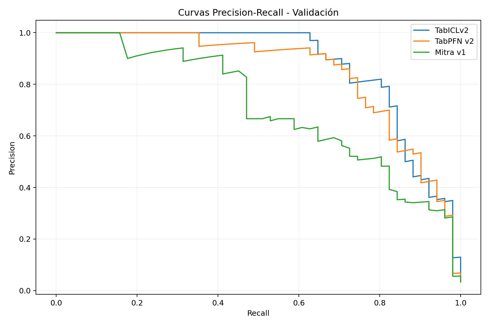
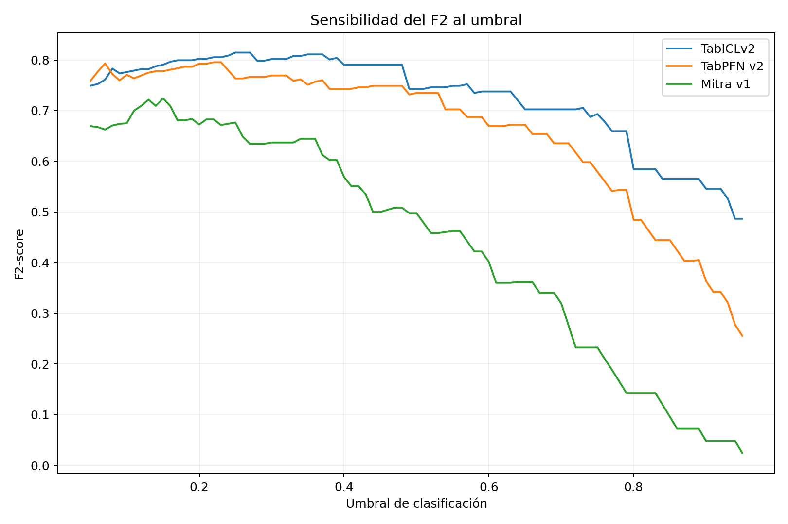
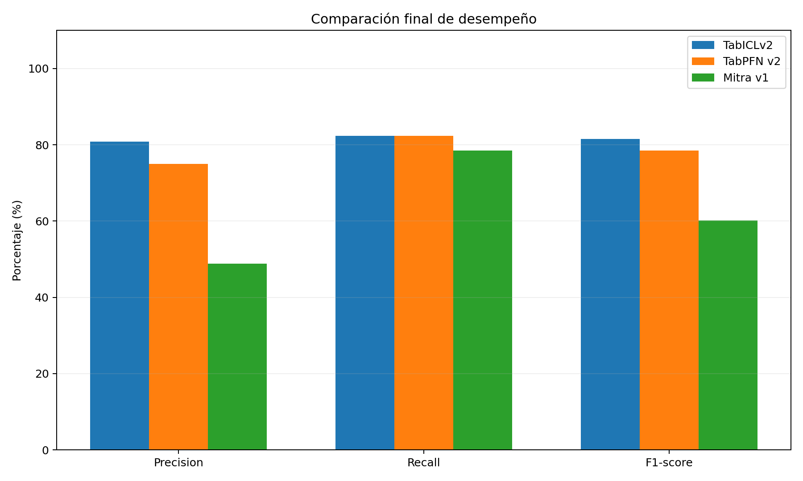
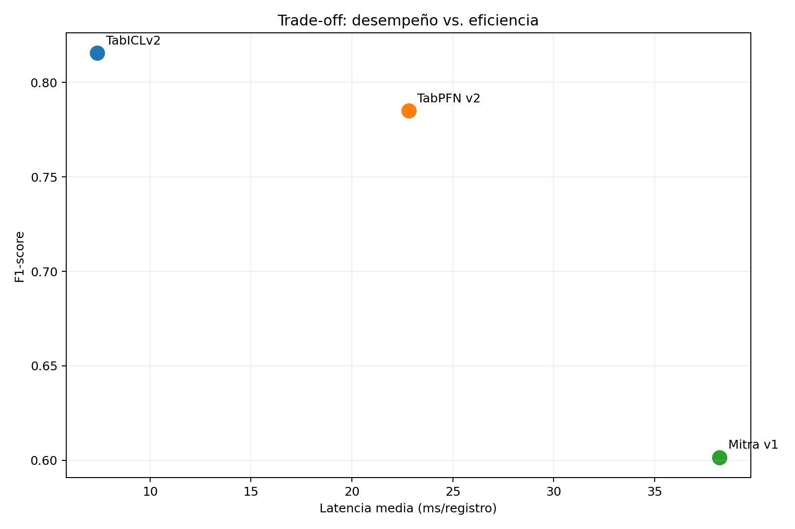

# Predictive Maintenance AI

## Actividad 4 — Evaluación de modelos preentrenados

**Asignatura:** Gestión de Proyectos de Inteligencia Artificial  
**Módulo:** 2 — Semana 5  
**Entorno:** Google Colab con GPU NVIDIA Tesla T4  
**Fecha de documentación:** 2026-10-18

---

## 1. Resumen ejecutivo

Este proyecto analiza la aplicación de modelos fundacionales preentrenados
para clasificar condiciones de falla en maquinaria industrial.

Se evaluaron tres modelos disponibles en el ecosistema Hugging Face:

- TabICLv2
- TabPFN v2
- Mitra v1

La comparación considera métricas de clasificación, detección de fallas,
latencia de inferencia y consumo de recursos.

El modelo seleccionado mediante validación fue
**TabICLv2**, con un umbral de **0.25**.

La selección se realizó antes de evaluar el conjunto de prueba.

## 2. Problema y caso de uso

Los paros no planificados de maquinaria pueden generar pérdidas de
productividad, costos correctivos y afectaciones a la operación.

El proyecto busca evaluar modelos que identifiquen condiciones
operativas asociadas con fallas.

**Alcance:** clasificación binaria de registros con y sin falla.

El dataset no contiene un horizonte futuro de predicción.
Por ello, los resultados no demuestran anticipación temporal de fallas.

## 3. Objetivos

- Identificar modelos preentrenados pertinentes.
- Implementar tres modelos mediante Google Colab con GPU.
- Aplicar métricas de clasificación.
- Comparar desempeño y eficiencia.
- Seleccionar un modelo mediante criterios reproducibles.
- Documentar resultados, riesgos y limitaciones.

## 4. Ecosistema Hugging Face

Hugging Face proporciona:

- **Models:** modelos y checkpoints preentrenados.
- **Datasets:** conjuntos de datos reutilizables.
- **Spaces:** aplicaciones y demostraciones.
- **Hub:** plataforma central de distribución.

En este proyecto se utilizan checkpoints públicos y bibliotecas
que permiten obtenerlos desde Hugging Face Hub.

## 5. Dataset

**Fuente:** UCI Machine Learning Repository.  
**Nombre:** AI4I 2020 Predictive Maintenance Dataset.  
**Identificador:** 601.  
**Naturaleza:** datos sintéticos.  
**Licencia:** CC BY 4.0.

Enlace:
https://archive.ics.uci.edu/dataset/601/ai4i+2020+predictive+maintenance+dataset

El conjunto contiene:

- 10,000 registros.
- 9,661 registros sin falla.
- 339 registros con falla.
- 6 variables predictoras originales.

### Diccionario de variables

| Variable | Descripción |
|---|---|
| Type | Categoría de producto: L, M o H |
| Air temperature | Temperatura del aire (K) |
| Process temperature | Temperatura del proceso (K) |
| Rotational speed | Velocidad de rotación (rpm) |
| Torque | Torque aplicado (Nm) |
| Tool wear | Desgaste de herramienta (min) |
| Machine failure | Etiqueta binaria de falla |

### Calidad de datos

No se encontraron valores faltantes.

La proporción de fallas es de 3.39%, lo que constituye un
problema de clasificación desbalanceada.

En consecuencia, accuracy no se utiliza como único criterio
para valorar los modelos.

## 6. Modelos evaluados

| Modelo | Repositorio | Licencia declarada |
|---|---|---|
| TabICLv2 | jingang/TabICL | BSD 3-Clause |
| TabPFN v2 | Prior-Labs/TabPFN-v2-clf | Prior Labs License 1.1 |
| Mitra v1 | autogluon/mitra-classifier | Apache 2.0 |

La selección inicial consideró:

- Compatibilidad con clasificación tabular.
- Disponibilidad de pesos preentrenados.
- Ejecución en GPU.
- Requisitos de memoria.
- Licenciamiento.
- Calidad predictiva.
- Latencia y eficiencia.
- Reproducibilidad.

Los términos completos de cada licencia deben revisarse
antes de cualquier utilización comercial.

## 7. Metodología experimental

### Partición de datos

| Conjunto | Registros | Fallas |
|---|---:|---:|
| Entrenamiento | 7,000 | 237 |
| Validación | 1,500 | 51 |
| Prueba | 1,500 | 51 |

Se realizó una separación estratificada con semilla 42.

La variable categórica Type se transformó mediante One-Hot Encoding.

El codificador se ajustó únicamente sobre entrenamiento.

La representación resultante contiene ocho características.

### Configuración de modelos

- TabICLv2: cuatro estimadores.
- TabPFN v2: cuatro estimadores y checkpoint V2.
- Mitra v1: un estimador, sin fine-tuning de pesos.
- Todos: ejecución con GPU CUDA.

Mitra utilizó una partición interna del 5% de sus datos
de entrenamiento, gestionada por AutoGluon.

Durante su ejecución, AutoGluon redujo su soporte de
contexto máximo de 8192 a 4096 debido a restricciones
de memoria. Esta circunstancia limita la equivalencia
exacta de las configuraciones entre modelos.

## 8. Resultados iniciales de validación

Los siguientes resultados utilizan umbral 0.50:

| Modelo | Accuracy | Precision | Recall | F1-score |
| --- | --- | --- | --- | --- |
| TabICLv2 | 98.53% | 82.22% | 72.55% | 77.08% |
| TabPFN v2 | 98.67% | 87.80% | 70.59% | 78.26% |
| Mitra v1 | 97.87% | 85.19% | 45.10% | 58.97% |

Los tres modelos se evaluaron sobre los mismos
1,500 registros de validación.

## 9. Optimización de umbrales

Se analizaron umbrales de 0.05 a 0.95.

El criterio de selección fue maximizar F2-score,
exigiendo precision mínima de 0.50.

Los umbrales se eligieron exclusivamente mediante
los datos de validación.

| Modelo | Umbral | Precision | Recall | F1-score | F2-score |
| --- | --- | --- | --- | --- | --- |
| TabICLv2 | 0.250 | 71.67% | 84.31% | 77.48% | 81.44% |
| TabPFN v2 | 0.220 | 70.00% | 82.35% | 75.68% | 79.55% |
| Mitra v1 | 0.150 | 51.90% | 80.39% | 63.08% | 72.44% |

## 10. Selección del modelo recomendado

**Modelo seleccionado:** TabICLv2

**Umbral seleccionado:** 0.25

**Criterio:** F2 máximo con precision >= 0.50

La decisión prioriza la detección de fallas mediante F2-score.

En caso de empate se consideran recall, F1-score y latencia.

La selección fue establecida antes de consultar los resultados
del conjunto de prueba.

## 11. Evaluación final independiente

Los siguientes resultados se obtuvieron sobre 1,500
registros de prueba, aplicando los umbrales seleccionados
previamente en validación.

| Modelo | Accuracy | Precision | Recall | F1-score |
| --- | --- | --- | --- | --- |
| TabICLv2 | 98.73% | 80.77% | 82.35% | 81.55% |
| TabPFN v2 | 98.47% | 75.00% | 82.35% | 78.50% |
| Mitra v1 | 96.47% | 48.78% | 78.43% | 60.15% |

### Desempeño del modelo seleccionado

En prueba, el modelo **TabICLv2** obtuvo:

- Precision: 80.77%.
- Recall: 82.35%.
- F1-score: 81.55%.
- Fallas detectadas: 42.
- Falsas alarmas: 10.
- Fallas no detectadas: 9.

Estos valores describen desempeño sobre el dataset
académico y no garantizan desempeño en producción.

## 12. Eficiencia y recursos

| Modelo | Latencia ms/registro | Memoria GPU MB | FP | FN |
| --- | --- | --- | --- | --- |
| TabICLv2 | 7.393 | 669.521 | 10 | 9 |
| TabPFN v2 | 22.807 | 296.341 | 14 | 9 |
| Mitra v1 | 38.210 | 6208.289 | 42 | 11 |

Las latencias representan promedios amortizados de
inferencia por lotes, con modelos previamente cargados.

La memoria corresponde al pico CUDA observado mediante
PyTorch. Las mediciones no son equivalentes a una
auditoría completa de memoria del sistema.

## 13. Riesgos y limitaciones

**Desbalance de clases:** únicamente 339 registros
originales corresponden a fallas.

**Tamaño de la prueba positiva:** existen 51 fallas
reales en el conjunto de prueba.

**Datos sintéticos:** no representan directamente
el comportamiento de una planta industrial real.

**Ausencia de temporalidad:** la etiqueta identifica
fallas en el registro, sin un horizonte de anticipación.

**Falsos negativos:** pueden representar fallas no detectadas.

**Falsos positivos:** pueden producir inspecciones innecesarias.

**Recursos computacionales:** la GPU disponible y la
configuración interna de cada modelo condicionan la latencia.

**Diferencias de configuración:** el número de estimadores,
la partición interna de Mitra y los límites de contexto
no son idénticos entre modelos.

**Reproducibilidad:** las versiones de bibliotecas están
registradas, pero los checkpoints remotos pueden cambiar
si no se inmovilizan sus revisiones exactas.

**Riesgo de generalización:** se requiere validación externa
antes de cualquier aplicación real.

## 14. Reproducibilidad

Notebook principal:

[Ejecutar en Google Colab](notebooks/PredictiveMaintenance_Actividad4.ipynb)

### Requisitos

- Cuenta de Google.
- Google Colab.
- Acelerador GPU compatible con CUDA.
- Acceso a los modelos públicos de Hugging Face.
- Python y bibliotecas del archivo requirements.txt.

### Procedimiento

1. Abrir el notebook desde la carpeta notebooks.
2. Activar GPU en Google Colab.
3. Ejecutar los bloques secuencialmente.
4. Descargar el dataset original desde UCI.
5. Preparar los conjuntos de datos.
6. Cargar los tres modelos preentrenados.
7. Evaluar validación y seleccionar umbrales.
8. Congelar la selección del modelo.
9. Ejecutar la evaluación final de prueba.
10. Generar gráficos, CSV y documentación.

El entorno observado queda registrado en
docs/environment.json.

Las particiones están documentadas en data/data_splits.csv.

Los resultados experimentales están disponibles en results/.

## 15. Estructura del repositorio

- README.md: reporte técnico.
- requirements.txt: dependencias.
- notebooks/: notebook ejecutable.
- data/: dataset y particiones.
- src/: funciones de evaluación.
- results/: métricas, predicciones y figuras.
- docs/: documentación y configuración.

## 16. Conclusiones

La actividad demuestra la viabilidad técnica de implementar
tres modelos fundacionales preentrenados para clasificación
de condiciones de falla sobre el dataset AI4I 2020.

La evaluación muestra que precisión, recall, F1-score y
eficiencia pueden conducir a decisiones diferentes.

La selección de **TabICLv2** se fundamenta en
el criterio F2 sobre validación, bajo una restricción mínima
de precision.

La evaluación final permite verificar el comportamiento
de dicha decisión sobre observaciones independientes.

Sin embargo, la solución requiere validación con datos
industriales reales, evaluación temporal y análisis
económico antes de plantear su despliegue productivo.

## 17. Referencias

1. UCI Machine Learning Repository. AI4I 2020.
   https://archive.ics.uci.edu/dataset/601/ai4i+2020+predictive+maintenance+dataset

2. Hugging Face. TabICL.
   https://huggingface.co/jingang/TabICL

3. Hugging Face. TabPFN v2.
   https://huggingface.co/Prior-Labs/TabPFN-v2-clf

4. Hugging Face. Mitra Classifier.
   https://huggingface.co/autogluon/mitra-classifier

5. Hugging Face Hub Documentation.
   https://huggingface.co/docs/hub

6. Google Colaboratory.
   https://colab.research.google.com/

7. Scikit-learn. Classification metrics.
   https://scikit-learn.org/stable/modules/model_evaluation.html
